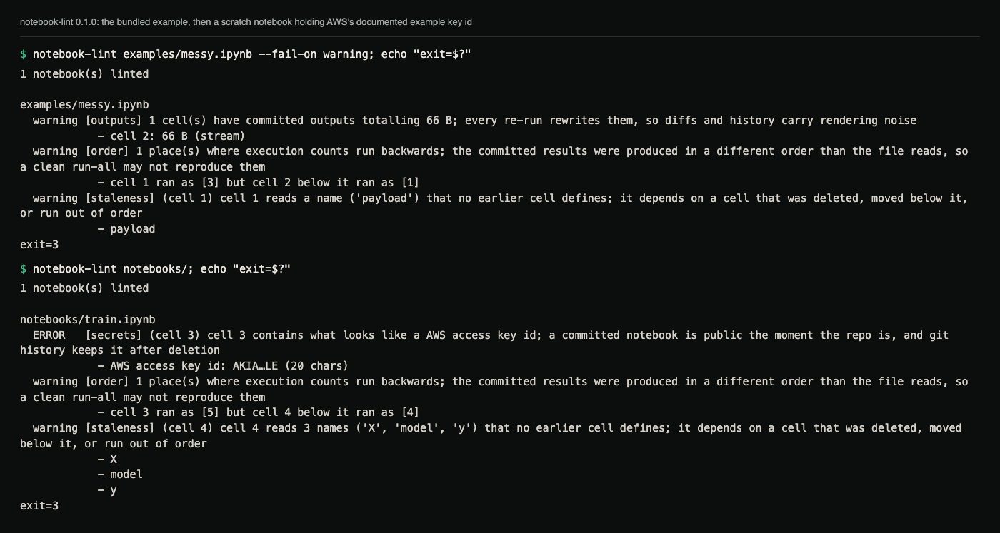

# notebook-lint

Lint Jupyter notebooks for the four ways a committed notebook goes bad:
outputs checked into git, credentials in cells, execution order that no
longer matches the file, and cells that can no longer run. Zero runtime
dependencies: Python 3.10+ and nothing else.

## Demo



Real output. The first run lints the notebook in `examples/`, which is
built to trip three warnings and to hold a placeholder credential that must
not fire. The second run is a scratch notebook (not in the repo) with AWS's
documented example key id in a cell; only the redacted form is printed.
Cell numbers are 0-based.

```console
$ notebook-lint examples/messy.ipynb --fail-on warning; echo "exit=$?"
1 notebook(s) linted

examples/messy.ipynb
  warning [outputs] 1 cell(s) have committed outputs totalling 66 B; every re-run rewrites them, so diffs and history carry rendering noise
            - cell 2: 66 B (stream)
  warning [order] 1 place(s) where execution counts run backwards; the committed results were produced in a different order than the file reads, so a clean run-all may not reproduce them
            - cell 1 ran as [3] but cell 2 below it ran as [1]
  warning [staleness] (cell 1) cell 1 reads a name ('payload') that no earlier cell defines; it depends on a cell that was deleted, moved below it, or run out of order
            - payload
exit=3
```

Without `--fail-on warning` the same run exits 0, because the default gate
is `error`.

## The four checks

- **outputs**: committed outputs rewrite on every run (diff noise) and git
  keeps every version forever; past 256 kB the finding escalates to an
  error, because megabytes of base64 have a way of containing what the code
  was careful not to print.
- **secrets**: vendor-shaped credentials (AWS, GitHub, Slack, Google,
  `sk-…` keys, private key blocks) plus name-and-value credential
  assignments, in cell sources **and in committed text outputs** (stream
  output, `text/plain` results, error tracebacks; up to 1 MB of text per
  cell). Precision over recall: placeholders (`<YOUR-KEY>`, `${API_KEY}`)
  don't fire, and evidence is always redacted to the first 4 and last 2
  characters plus the length (values of 8 characters or fewer: first 2),
  enough to locate, not to reuse. Images and other binary outputs are not
  scanned.
- **order**: `execution_count` running backwards means the committed
  results came from a different order than the file reads; outputs on a
  never-executed cell cannot have come from the committed code at all.
- **staleness**: judged statically and honestly: a cell that doesn't parse
  cannot run; a top-level read of a name no earlier cell defines depends on
  a cell that was deleted or moved below it. IPython line magics and shell
  escapes are blanked, non-Python cell magics (`%%bash`, `%%writefile`,
  `%%html`, …) are skipped while `%%time`/`%%timeit`/`%%capture`/`%%prun`
  bodies are still checked, reads inside function and lambda bodies are
  left alone, undefined-name findings stop after a `from … import *`
  (the names become unknowable), and non-Python notebooks are skipped
  rather than guessed at.

## Installation

Not published on PyPI; install from a clone (Python 3.10+):

```console
git clone https://github.com/hellpuffyt/notebook-lint
cd notebook-lint
python -m pip install -e .
```

## Usage

```console
notebook-lint nb.ipynb other/          # files and directories mix freely
notebook-lint . --format json          # machine-readable, same content
notebook-lint . --check secrets        # one checker only (repeatable)
notebook-lint . --fail-on warning      # stricter CI gate
```

Exit codes are the CI interface: `0` clean at the chosen threshold, `1` bad
input or usage, `3` findings at or above `--fail-on` (default: `error`).
`.ipynb_checkpoints` copies are always skipped.

Severities: a secret, a cell that does not parse, and outputs of 256 kB or
more are `ERROR`; everything else is a `warning`. `--fail-on never` always
exits 0 after printing. JSON output is one document with `notebooks`,
`findings` (each with `check`, `severity`, `message`, `path`, `cell`,
`evidence`) and a `summary` count per severity.

## What it deliberately does not do

- **No execution.** Running the notebook needs its kernel, packages and
  data; a linter has none of them. Every check here is static and says so.
- **No fixing.** Stripping outputs or rewriting cells is a decision;
  the tool reports, you decide. (Pair with `nbstripout` if you want the
  former automated.)

## Development

```console
pip install -e ".[dev]"
pytest
ruff check .
mypy
```

81 tests, no network. CI runs them on Linux, macOS and Windows for Python
3.10 to 3.13, plus ruff, strict mypy, a 95% coverage gate, and an
end-to-end job that lints `examples/` and asserts the exit codes and the
exact set of checks that fire. See [CONTRIBUTING.md](CONTRIBUTING.md) and
[CHANGELOG.md](CHANGELOG.md).

Security issues: please report privately via
[GitHub security advisories](https://github.com/hellpuffyt/notebook-lint/security/advisories/new)
(see [SECURITY.md](SECURITY.md)).

MIT licensed, see [LICENSE](LICENSE).
